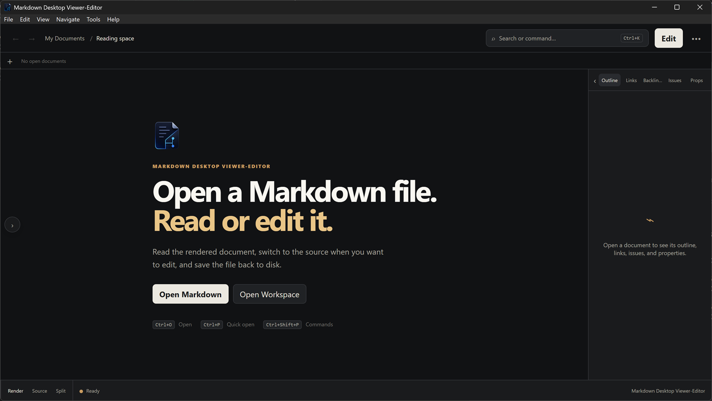
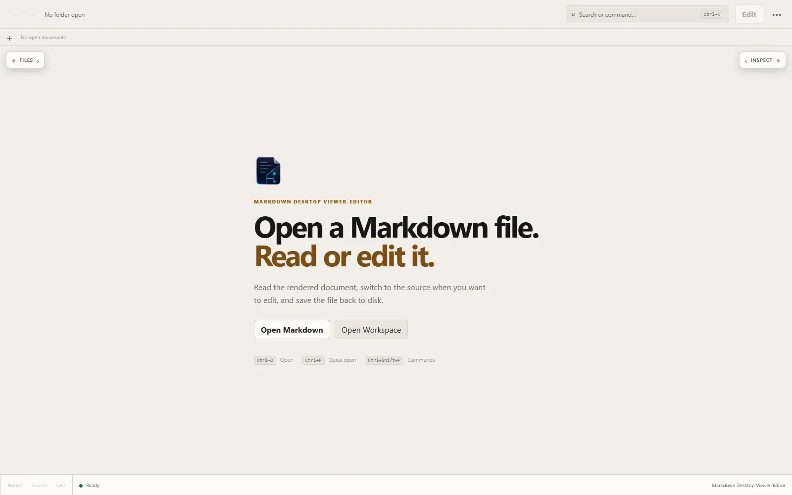
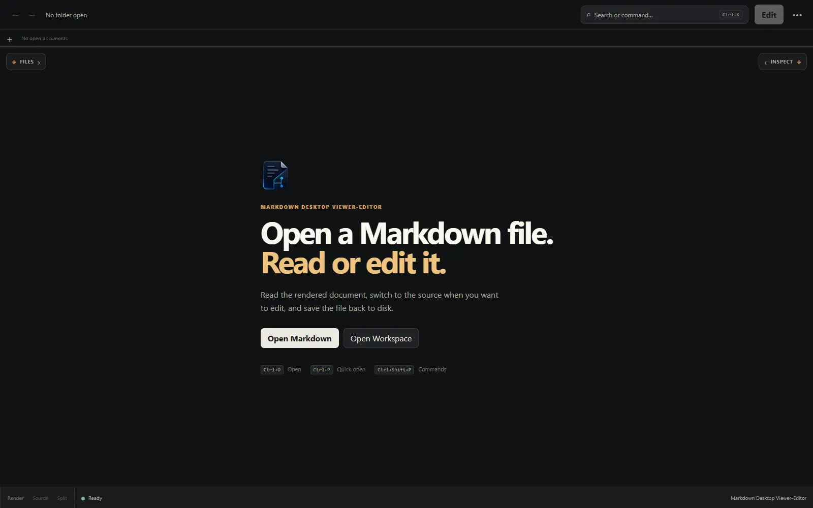

#  Markdown Desktop

A local-first Markdown reader and editor for people who want comfortable documents—not an IDE, a browser tab, or a plain-text compromise.

<p align="center">
  <a href="https://github.com/ImYourBoyRoy/markdown-desktop/actions/workflows/ci.yml"></a>
  <a href="https://github.com/ImYourBoyRoy/markdown-desktop/releases/latest"></a>
  <a href="./LICENSE"></a>
</p>

<p align="center">
  <a href="https://github.com/ImYourBoyRoy/markdown-desktop/releases"></a>
  <a href="https://github.com/ImYourBoyRoy/markdown-desktop/releases"></a>
  <a href="https://github.com/ImYourBoyRoy/markdown-desktop/releases"></a>
</p>

<p align="center">
  <a href="https://github.com/ImYourBoyRoy/markdown-desktop/releases">Download</a>
  ·
  <a href="https://github.com/ImYourBoyRoy/markdown-desktop/issues">Issues</a>
  ·
  <a href="./LICENSE">MIT license</a>
</p>

Open a `.md` file or folder and get a real document view immediately. Read the rendered page, switch to source when you need precise control, make safe visual edits, and save the ordinary Markdown file back to disk. Markdown remains the source of truth: there is no proprietary document format, sync service, or conversion step.

Markdown Desktop is also a practical cleanup layer for AI-assisted documentation. Inspect generated Markdown, correct it in Rendered or Source mode, and keep the finished file on your machine. The current editor makes no provider calls by default.

## Why use it?

Markdown is excellent for durable documents, but the usual choices are awkward: open an IDE and bring along a whole development environment, or use a plain text editor and give up the comfort of a document reader. Markdown Desktop keeps the useful parts of both without the heavy guff.

- Read Markdown as a polished document instead of a wall of syntax.
- Edit visually when that is faster, then open the source drawer when exact Markdown matters.
- Keep files local, ordinary, portable, and compatible with the tools that already understand Markdown.
- Work with documentation, notes, README files, issue drafts, diagrams, and AI-generated text in one focused desktop app.

<p align="center">
  
</p>

## What you get

- **Rendered, Source, and Split** views, plus a persistent startup choice for Remember last used, Rendered, Source, or Split.
- **Source-preserving visual editing** for supported headings, paragraphs, leaf list items, simple table cells, inline marks, direct links, direct images, task state, and details summaries, with source-range undo/redo.
- **Synchronized source and rendered selection**, hover, highlights, and navigation through mapped blocks, tables, images, links, fences, and diagrams.
- A full editor ribbon and slash-command surface for headings, lists, formatting, tables, code, links, images, local/direct video, approved provider embeds, quotes, alerts, details, diagrams, math, footnotes, rules, and `/toc`.
- Context-aware source completion for the shared slash-command catalog, current-document heading anchors, reference labels, authorized workspace Markdown paths, fence languages, Extended HTML tags/attributes, explicit Markdown block snippets, and document-word completion.
- Block movement, visible drag feedback, block deletion with undo, contextual block properties, fence-language editing, code copy, image replacement, safe image sizing/alignment, and themed context menus.
- Workspace file trees, full-text search with matching-line navigation, inbound backlinks, tabs, outline, recent files, link and issue panels, and GitHub/CommonMark/Extended compatibility profiles. External changes refresh the active workspace index and tree.
- Delayed local Markdown diagnostics for duplicate headings/references, unclosed fences, empty image alt text, empty link destinations, and non-portable inline event handlers, alongside native filesystem/reference lint. Issues select the exact source range; safe fixes are revision-checked and undoable.
- Optional platform spell-check indicators for editable text, with code blocks excluded and a privacy-aware Settings switch.
- Sanitized Markdown rendering with safe local and remote assets, image/video/embed/diagram previews, Mermaid, Extended-profile Graphviz, drag-and-drop image import, and document-relative asset management.
- Atomic saves that preserve UTF-8/UTF-16 encoding, BOM, line endings, and final newline, plus recovery snapshots and conflict handling when a file changes outside the app. Quitting waits for saves or recovery snapshots; failed writes keep your edits open.
- Native menus, file associations, keyboard shortcuts, light/dark themes, reader focus mode, and a calm GitHub-oriented Issues view.

<table>
  <tr>
    <td align="center"><strong>Light</strong><br /></td>
    <td align="center"><strong>Dark</strong><br /></td>
  </tr>
</table>

<p align="center">
  
</p>

## A comfortable workflow

1. **Open a file or folder.** The Files sidebar shows Markdown documents, workspace search finds content across the folder, and Open Recent keeps up to five local paths available.
2. **Read without distraction.** Use Rendered mode for a clean document view, Split mode when comparing source and output, or **Focus reader** / **F11** when the document deserves the whole window.
3. **Edit at the right level.** Click a supported rendered block to edit it in place, use the source drawer for exact syntax, or use the ribbon and slash commands for structured inserts. Unsupported or ambiguous edits stay source-only instead of guessing.
4. **Review and save.** Find and replace works against the current Markdown with synchronized highlights. Save preserves the source file’s formatting, while recovery and conflict handling protect work when the disk changes elsewhere.

The rendered editor uses a capability-aware boundary. Direct inline images can
keep ordinary `` Markdown or opt into explicit safe HTML
`width`, `height`, and `align` attributes from the Block ribbon. Resolved
reference-style images/links can update their shared definition in place,
including common multiline reference titles. Raw HTML links and images expose
only safe property updates while preserving authored attributes and bodies. A
reference image can explicitly convert only the selected occurrence to HTML
when sizing or alignment is needed; other occurrences remain linked to the
shared definition. Unresolved references, nested-list containers, and arbitrary
HTML remain source-assisted so a visual action never silently rewrites a larger
structure.

## Why the editing feels safe

Rendered typing patches the mapped Markdown range instead of serializing the rendered DOM back into a new document. Existing markers, inline wrappers, link destinations, entities, line endings, and unrelated formatting stay intact. When a visual position is ambiguous, the app leaves the source editor available rather than applying a risky edit.

Rendered text selection and block dragging keep visible feedback attached to the source interval being changed. Block moves use bounded vertical `before`/`after` source transactions and retain keyboard movement as a fallback; arbitrary side-by-side columns are not exposed because they have no safe portable Markdown representation. Source selection can reveal the matching rendered text, and history actions restore a previously rendered revision when the mapping remains exact.

Opening a larger document uses an explicit loading surface for native read/decode/render work and preview/editor mounting. The shell yields before the larger WebView commit can paint, reports source size without inventing a false percentage, and keeps the document pane unavailable until the new revision is mounted. Large sanitized previews mount in bounded top-level batches with cancellation and one final source-map pass, so browser input and paint are not monopolized by one full-document DOM task. Reader-only large documents also use native `content-visibility` containment to reduce offscreen paint/layout work. The editable surface keeps stable mapped DOM because caret, selection, IME, and drag contracts depend on it.

Media follows the same progressive policy. `/media`, `/video`, and `/embed` plus Insert → Media create source-preserving HTML5 video or a controlled YouTube, Vimeo, or Google Drive embed; arbitrary iframe providers are removed at the native render boundary. Local and direct video assets are validated and bounded in Rust, then loaded only near the viewport. A subtle shimmer is delayed until an asset or optional renderer has actually taken long enough to notice, so fast previews do not flicker while slow previews do not look frozen. The lightbox is display-only and does not rewrite Markdown.

Completion and review remain source-aware. The source editor offers suggestions only in a recognizable Markdown context, exposes explicit block snippets with `Ctrl+Space`, and uses the current workspace tree for relative Markdown targets; it does not scan arbitrary folders. Extended-profile HTML suggestions are limited to safe attributes for the element being authored. The Rendered slash menu and ribbon continue to use the same command availability rules. Spell checking is a local WebView hint rather than a document-upload service; rendered editing enables it on the focused prose block so large documents stay responsive, and the Settings switch makes that behavior explicit.

## Markdown, diagrams, and compatibility

The default `github` profile favors Markdown that travels well: relative asset paths, GFM tables, documented marks, footnotes, dollar-delimited math, and GitHub alert syntax. `commonmarkStrict` and `extended` profiles make the compatibility tradeoff explicit. GitHub-oriented Issues remain advisory; they do not change rendering, editing, or save behavior.

Mermaid fences work in the GitHub profile. Graphviz/DOT is an explicit Extended-profile local preview and is marked non-portable in the GitHub and CommonMark profiles. Mermaid and Graphviz runtimes are lazy-loaded instead of being placed in the startup JavaScript graph, but both are shipped locally inside the application so diagrams work offline and do not depend on a network request. The production build enforces explicit renderer entry, total, and largest-chunk budgets; `pnpm audit:renderers` reports the same gate without rebuilding. Mermaid 12 uses native SVG text for readable, sanitized diagrams; the macOS bundle therefore requires macOS 14.4 or newer. See the [Mermaid configuration](https://mermaid.js.org/config/configuration) and [flowchart](https://mermaid.js.org/syntax/flowchart.html) documentation for the upstream syntax.

Video support covers document-relative files, direct HTTPS video files, and validated provider links; autoplay is never generated. Local videos up to 2 GiB use opaque native grants and reads capped at 8 MiB per range; the platform WebView must support the file's codec and range requests. Direct remote video remains capped at 32 MiB. Provider embeds use HTTPS-only allowlisted origins and remain network-dependent. Remote media follows the remote-image setting and stays inert until allowed and near the viewport. **Refresh preview** retries assets and rendering; preview dialogs also offer **Reload preview**.

Rendered Markdown, local assets, and remote assets are sanitized and constrained by the native Rust host. GitHub README size and repository-object guidance appears as a calm advisory with links to [README limits](https://docs.github.com/en/repositories/managing-your-repositorys-settings-and-features/customizing-your-repository/about-readmes), [repository limits](https://docs.github.com/en/repositories/creating-and-managing-repositories/repository-limits), and [large files](https://docs.github.com/en/repositories/working-with-files/managing-large-files/about-large-files-on-github).

## Download

Installers and portable builds are available on the [Releases](https://github.com/ImYourBoyRoy/markdown-desktop/releases) page. The release workflow targets six platform families:

| Platform | Installer | Other packages |
| --- | --- | --- |
| Windows x64 | `Markdown-Desktop-<version>-Windows-x64-setup.exe` | `.msi`, `-Portable.exe` |
| Windows ARM64 | `Markdown-Desktop-<version>-Windows-ARM64-setup.exe` | `.msi`, `-Portable.exe` |
| macOS Apple Silicon | `...-macOS-Apple-Silicon.dmg` | `.app.tar.gz` |
| macOS Intel | `...-macOS-Intel.dmg` | `.app.tar.gz` |
| Linux x64 | `...-Linux-x64.AppImage` | `.deb`, `.rpm` |
| Linux ARM64 | `...-Linux-ARM64.AppImage` | `.deb`, `.rpm` |

The current macOS packages are intentionally unsigned because Apple Developer signing and notarization are not configured. Verify trusted release assets before opening them; macOS may show an unidentified-developer warning. Signed updater metadata is verified by the release workflow.

## Install

### Windows

Run the x64 or ARM64 `-setup.exe` that matches your device, or use the matching `.msi`. The NSIS installer includes the WebView2 bootstrapper when needed. The portable executable runs without an installation or Start menu entry.

### macOS

Open the matching `.dmg` and drag **Markdown Desktop** into Applications. For the current unsigned packages, verify the release asset first, then use Finder’s context menu → **Open** if macOS shows an unidentified-developer warning.

### Linux

```bash
chmod +x ./Markdown-Desktop-*-Linux-x64.AppImage
./Markdown-Desktop-*-Linux-x64.AppImage
```

Use the matching `Linux-ARM64` name on ARM64. To install a package instead:

```bash
sudo apt install ./Markdown-Desktop-*-Linux-x64.deb
# or
sudo dnf install ./Markdown-Desktop-*-Linux-x64.rpm
```

Tauri’s [platform prerequisites](https://v2.tauri.app/start/prerequisites/) apply. Windows uses WebView2 and Linux uses WebKitGTK; the release matrix exercises those native dependencies.

## Uninstall

Uninstall through Windows Settings, macOS Applications/Finder, or your Linux package manager. Your Markdown files are never deleted. Application settings, recovery data, search indexes, logs, and WebView caches live separately from the documents and can be removed when you want a clean reset.

## Development

Requires Node.js 26.x, pnpm 12.3.4 or newer, Rust stable meeting the manifest minimum, and the [Tauri platform prerequisites](https://v2.tauri.app/start/prerequisites/).

```bash
pnpm install --frozen-lockfile
pnpm tauri dev
```

Run the focused checks that match the work you are changing:

```bash
pnpm check:toolchains
pnpm check
pnpm test
pnpm build
pnpm audit:renderers
pnpm smoke:visual
pnpm smoke:block-drag
pnpm smoke:media-privacy
pnpm smoke:lifecycle
pnpm smoke:renderers
pnpm smoke:packaged
pnpm wcagate:verify
pnpm architecture:check
pnpm test:architecture
pnpm verify:dependencies
pnpm tauri build
```

The latest local release-candidate checkpoint (2026-10-16) used Node 26.9.0,
pnpm 12.14.0, and stable Rust/Cargo 1.99.1. The `1.1.2` Windows x64 candidate
passed the dependency verification gate, `pnpm tauri build`, `pnpm build:app`,
and packaged acceptance at 20/20 checks. WCAGate covered 4,143 surfaces with
zero active findings; its one bounded shutdown-dialog `cantTell` suppression is
fingerprinted, expiry-bound, and backed by the tracked manual contrast evidence
in `wcag-audit/manual-evidence.json`. The dependency is current at upstream
revision `30be59d61db6f1cc3c5e80701fb28a0346588ca7`. This is local Windows
evidence for an unpublished candidate; the release matrix, exact-commit GitHub
CI, signing, target-OS accessibility, and live updater-install checks still
require their respective environments.

`pnpm full:upgrade` refreshes WCAGate to the latest upstream `main` commit,
locks that exact revision, and reruns the accessibility gate before the rest of
the release checks.

`pnpm smoke:block-drag` uses a real mouse gesture in headless Chromium. `pnpm smoke:media-privacy` checks actual browser request behavior; `pnpm smoke:lifecycle` exercises the real application UI with simulated IPC. `pnpm wcagate:verify` starts its own local server and runs WCAGate doctor and the accessibility gate over welcome, settings, documents, editing, recovery, and shutdown. `pnpm smoke:packaged` launches the built desktop binary for synthetic rendered/source editing, offline Mermaid SVG loading, undo/redo, Save/reload, Find, selection, composition, pointer dragging, split-mode latency, and native video decoding/seek. These checks do not replace physical keyboard, pointer, IME, screen-reader, compositor, or target-OS acceptance.

The CI and release workflows also run the packaged interaction acceptance against
the staged Windows x64 binary before native artifacts are accepted or uploaded.
The other platform lanes retain native artifact and branding smoke coverage; they
do not claim Windows WebView interaction coverage.
Release builds and publication also depend on the reusable CI quality/security
and six-platform native checks at the release source commit. Publishing an
existing draft requires selecting that draft's exact tag commit.

`pnpm build:app` stages unsigned portable and installable outputs under `Apps/`. Signed release builds use `pnpm build:release` with `TAURI_SIGNING_PRIVATE_KEY` or `TAURI_SIGNING_PRIVATE_KEY_PATH`.

## Privacy and updates

Documents stay on your machine in the current editor; opening a file makes no provider call. Markdown rendering is sanitized, and filesystem and remote-asset access are restricted in the Rust host. Remote video files and provider embeds only contact their declared origin when the user has remote assets enabled and the rendered object is requested. Future assistant features will require an explicit provider and bounded context before Markdown leaves the machine.

**Help → Check for Updates** checks a signed update manifest from GitHub Releases. Updates are never downloaded or installed until you confirm. A failed download or install remains retryable, and the signing private key is not stored in this repository. Remaining upstream Linux dependency advisories are documented in [SECURITY.md](./SECURITY.md).

## About and support

The in-app About dialog links to the [GitHub repository](https://github.com/ImYourBoyRoy/markdown-desktop) and [Roy Dawson IV](https://imyourboyroy.com). If Markdown Desktop is useful to you, the dialog also includes an optional [Venmo support link](https://account.venmo.com/itsyourboyroy); it is a secondary, non-blocking action.

## Technical documentation

- [ARCHITECTURE.md](./ARCHITECTURE.md) — ownership, data flow, revision identity, selection mapping, and performance boundaries.
- [IMPLEMENTATION_STATUS.md](./IMPLEMENTATION_STATUS.md) — the durable local implementation and release-readiness checkpoint.
- [docs/PHASE-0-PERFORMANCE.md](./docs/PHASE-0-PERFORMANCE.md) and [docs/PHASE-1-PERFORMANCE.md](./docs/PHASE-1-PERFORMANCE.md) — repeatable performance baselines and packaged-WebView boundaries.
- [SECURITY.md](./SECURITY.md) — security boundaries and remaining upstream advisories.

## License

MIT. See [LICENSE](./LICENSE).
